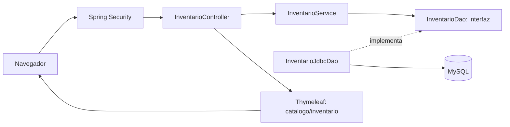

# Arquitectura inicial de Telar MX

## Alcance

Se conserva el proyecto existente y se establece el módulo de inventario como referencia de arquitectura. Los demás módulos conservan sus implementaciones; esta entrega no afirma que todos estén desacoplados.

## MVC y DAO

- Modelo: `ResumenInventario` transporta los artículos y totales.
- Vista: plantilla Thymeleaf existente; conserva sus atributos y comportamiento.
- Controlador: recibe HTTP, obtiene el resumen y prepara el modelo; no ejecuta SQL.
- Servicio: ofrece el caso de uso de consulta y depende de una interfaz.
- DAO: `InventarioDao` define el contrato; `InventarioJdbcDao` implementa las consultas JDBC.

## SOLID aplicado al inventario

| Principio | Aplicación |
|---|---|
| S | Controlador, servicio y DAO tienen responsabilidades distintas. |
| O | Puede añadirse otro DAO sin cambiar el controlador o el servicio. |
| L | Una implementación alternativa debe respetar el contrato de `consultar()`: resumen no nulo y conteos cero cuando no hay registros. |
| I | Interfaz DAO pequeña, limitada a la consulta de inventario. |
| D | Servicio dependiente de `InventarioDao`, inyectado por constructor; los tests sustituyen ese contrato con Mockito. |

## TDD

`InventarioTest` se escribe antes de las clases nuevas: primero falla por ausencia de `InventarioDao`, `ResumenInventario` e `InventarioService`. Luego se implementa el contrato y se repiten las pruebas. Los casos verifican inventario vacío, conservación de los resultados y compatibilidad de atributos de la vista.

Para nuevas funcionalidades: escribir una prueba de comportamiento que falle, implementar el mínimo y refactorizar manteniendo todas las pruebas en verde. Registrar estos pasos en commits o en el Pull Request; las pruebas heredadas no acreditan retrospectivamente TDD.

## Seguridad

Se conserva la configuración existente: autenticación, autorización por rol, CSRF y BCrypt. `SeguridadWebTest` verifica con la cadena real de filtros (sin MySQL) la redirección del anónimo, rechazo de vendedor en usuarios, acceso de administrador, consulta del vendedor, logout con/sin CSRF y verificación de contraseñas.

Las consultas de inventario son constantes y no reciben SQL del navegador. Los DAO que reciben valores deben usar parámetros JDBC. Usar credenciales por entorno; los valores por defecto actuales son solo para desarrollo. No utilizar usuarios ni datos de demostración en producción.

Estas pruebas no sustituyen una auditoría completa de seguridad ni prueban el motor MySQL. Antes de producción siguen pendientes, entre otros, revisar permisos de la BD, secretos, HTTPS y configuración de sesión del despliegue.

## Deuda identificada

`StockService`, `CrudService`, módulos de compras/ventas/producción y `UsuarioActual` todavía contienen acceso JDBC. Migrar progresivamente sus consultas a contratos DAO con pruebas de comportamiento. No se ha verificado la concurrencia de los movimientos de stock en esta entrega.

## GitHub

Rama: `feature/arquitectura-inicial`. El workflow ejecuta Maven `verify` con Java 25 y conserva los reportes JUnit. La verificación local puede usar Java 21 con `-Djava.version=21` si se declara expresamente; eso no acredita una ejecución con Java 25. La publicación y el resultado de Actions deben comprobarse en GitHub.

Resultado local y límites: ver [VALIDACION.md](VALIDACION.md). La prueba de arranque usa H2 en memoria solo en tests. Mockito se configura como agente explícito de Surefire.
